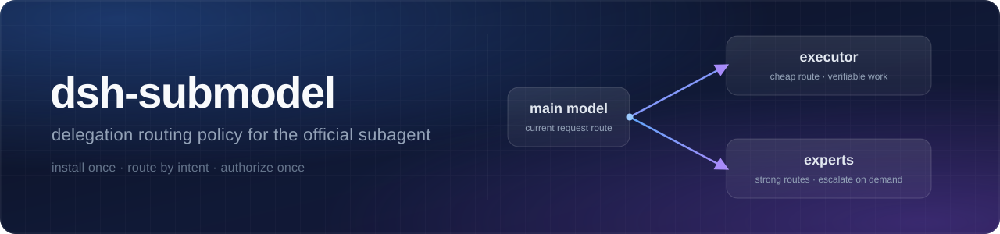

# dsh-submodel

**Two-way cross-model delegation policy for the official subagent.** A strong main model hands routine execution down to a cheaper model; a cheap main model escalates architecture-level problems to a strong one — routine token spend stays cheap, hard problems still get a strong model.

> **What it solves**
> - **Routine execution and retrieval** stay on a cheap model (e.g. DeepSeek Flash), so expensive models stay out of routine work.
> - **Architecture and complex code or logic** escalate to a strong expert model (e.g. Claude).
> - **Both directions**: whichever model is the main one, work goes to the right tier; delegated subagents cannot delegate further.
> - You configure the provider/model behind each route; the policy text ships with no provider or model names.



[](https://www.npmjs.com/package/dsh-submodel)
[](https://www.npmjs.com/package/dsh-submodel)
[](https://github.com/angel291592/dsh-submodel/blob/main/LICENSE)
[](https://github.com/angel291592/dsh-submodel)
[](https://github.com/angel291592/dsh-submodel/actions/workflows/ci.yml)
[](https://awesome-dsh-plugin.com)

[中文](README.md) | **English**

Open **Plugins → Subagent model settings** to order the cost-effective and expert model groups and add a note about what each model is good for; the list shows each model's channel. The main model can choose where to start. With automatic switching enabled, eligible failures move forward from that choice. DSH manages providers, credentials, and model permissions.

## Who it is for

- You already use **DSH** and have access to two or more model tiers (for example a cheap executor plus one strong expert model).
- Your main agent spends most of its time on **routine work** — running tests, small fixes, retrieval, tidying — billed at the expensive tier.
- You still want architecture calls and hard logic review decided by the strong model, rather than switching everything to the cheap one.

A single model tier works too: without an expert group, it only routes verifiable execution to the executor route.

<details>
<summary>Contents</summary>

- [Who it is for](#who-it-is-for)
- [Install](#install)
- [Configuration (two steps)](#configuration-two-steps)
- [Usage reminders and automatic switching](#usage-reminders-and-automatic-switching)
- [How it decides who does what (route-based since 0.2.0)](#how-it-decides-who-does-what-route-based-since-020)
- [Team formation self-check (optional, 0.3.0+)](#team-formation-self-check-optional-030)
- [Relationship to the official plugins](#relationship-to-the-official-plugins)
- [Compatibility](#compatibility)
- [Troubleshooting](#troubleshooting)
- [Known limitations](#known-limitations)
- [Rollback](#rollback)
- [Development and verification](#development-and-verification)
- [Contributing](#contributing)
- [Releasing (maintainers)](#releasing-maintainers)

</details>

## Install

```bash
dsh plugin --profile <your-profile> add dsh-submodel   # 1. install
dsh --profile <your-profile>                           # 2. start (restart the profile after adding)
# 3. on the first session, follow "Configuration (two steps)" below; or call configure_submodel
```

> If it saves you tokens on routine work, a star on the repository is the most direct way to help others find it.
> You can also share your routing setup in [Discussions](https://github.com/angel291592/dsh-submodel/discussions).

## Configuration (two steps)

Delegating to a different model requires choosing preferences and allowing that model in DSH:

| Layer | What it controls | If missing |
|---|---|---|
| ① Host authorization | Which models new conversations may delegate to | The current conversation cannot delegate to a different, unauthorized model |
| ② Plugin preferences | The default execution model and the expert models to choose from | A strong main agent without an execution model cannot select a default for routine delegation |

### ① Host authorization (required)

By default the native `subagent` only lets a child inherit the parent session's route. To let a child switch
to an execution/expert route, authorize it in the host first:

- **UI:** open **Subagent** settings under Plugins, turn on model selection, and allow each execution, expert, and fallback model you intend to use.
- **Or write the profile patch YAML** (`~/.dsh/profiles/<your-profile>/cordis.patch.yml`; the file is an empty
  array `[]` by default — append the entry to that array):

```yaml
- id: subagent-model-selection-settings
  config:
    enabled: true
    allowedModels:
      - provider: your-provider
        model: your-model
      - provider: your-provider
        model: your-strong-model
      - provider: your-other-provider
        model: your-backup-model
```

Note: `allowedModels` must not be empty when `enabled: true`; host authorization only applies to **new
sessions**, so open a new session (or restart the profile) after writing it.

### ② Plugin configuration

**Settings page:** open **Plugins → Subagent model settings**. Add models to either group, change the order, and enter short notes such as “Prefer for code”. The first model in each group is the usual starting point; the main model can use the notes to pick another one. Allow each model separately in Subagent settings. If another page saves first, your draft is kept. Load the saved settings and review the draft before saving it. Reload the page if the connection changes.

**First-run wizard:** call `configure_submodel` from a top-level agent with `autoConfigure` on and no execution model configured. It asks for execution and expert models first, then asks separately whether to add host authorization. The two writes are separate; the wizard reports which succeeded. Saving an execution model hides the wizard.

**Without the settings page:** add or update the `submodel` entry in your profile patch. Keep any other fields in that entry. If the host cannot show question cards, the wizard explains how to configure preferences and authorization manually.

```yaml
- id: submodel
  config:
    modelGroups:
      executors:
        - { provider: your-provider, model: your-model, note: Prefer for code }
        - { provider: your-other-provider, model: your-backup-model }
      experts:
        - { provider: your-provider, model: your-strong-model, note: Architecture decisions }
```

Note: a profile patch **replaces the whole `config` block** of an entry — fields you leave out fall back to
their defaults (see the table below); they are not merged field by field with the built-in defaults.

Full field reference:

| Field | Default | Description |
|---|---|---|
| `enabled` | `true` | Master switch; when `false`, only an empty prompt section is registered and no tools/guards are installed |
| `autoConfigure` | `true` | Whether to register the `configure_submodel` wizard for first-run setup (visible only for a top-level agent whose `executor` is not configured); turn it off to configure everything manually |
| `preset` | `standard` | Only applies to that composition |
| `teamFit.enabled` | `false` | Team formation self-check section (0.3.0+): needs the master `enabled` switch to be `true` as well, plus the official Agent Teams plugin; visible only to the top-level main model of the target preset — see below. Off by default, which is the rollback state |
| `modelGroups` | `legacy` (use previous settings) | Ordered `executors` and `experts` lists. Each entry is `{provider, model, note?, reasoningEffort?}`. Pairs may not repeat within a group. Every model can have a default reasoning effort: it applies when a delegation names no effort and when switching lands on that model; empty leaves it to the model, and an effort named in the call wins |
| `executor`, `experts` | Unset | Used only before saving the group lists. Omitting the old executor's `reasoningEffort` keeps `max`; `""` leaves it to the model |
| `economyRoutes` | `[]` | Extra cost-effective routes, each `{provider?, model}`. Omit `provider` to match on `model` alone. When non-empty, the legacy `flash` suffix rule no longer applies |
| `texts.economize` / `texts.boss` / `texts.child` | empty | When non-empty, replaces the built-in prompt section verbatim (no interpolation afterwards) |
| `toolName` | `list_subagent_models` | Tool name used as the capability gate for the policy section |
| `order` | `2850` | Order of the policy section in the system prompt |
| `guardNativeSubagent` | `true` | Requires a complete provider and model pair when a strong main agent calls the native `subagent` directly |
| `fallbacks` | `[]` | Legacy only. Entries are `{primary: {provider, model}, alternatives: [...]}`. Saving the new groups switches to their order |
| `watchdog.mode` | `off` | `off` disables monitoring, `notify` reminds the child to finish, `stop` prompts for a manual stop after the grace period, and `retry` retries eligible failures |
| `watchdog.tiers` | `[expert]` | Monitor `expert` and/or `executor` |
| `watchdog.warnTokens` | `100000` | Threshold for cumulative reported token usage (a positive integer) |
| `watchdog.graceMs` | `60000` | `1000`–`600000` milliseconds after the finish-up reminder is delivered |
| `watchdog.maxRetries` | `1` | Maximum number of automatic retries per task, `0`–`2` |

## Usage reminders and automatic switching

**Usage reminders** are off by default. They apply to selected groups of local subagents started through `delegate_task`. Usage comes from the reported totals; a single request can go over the reminder amount. Missing and explicitly zero usage are indistinguishable in the current host, so both count as unknown. The page shows the wait in seconds. At the end of that wait, it prompts you to stop the task yourself.

**Try the next model after failure** uses the next entry in the same group only when the current model has exhausted the host's bounded retries (five after the first failure by default, and no switch if it ran fewer than five). The task needs known usage below the reminder amount, with no partial output, tool calls, manual stop, or outside follow-up. The order starts at the chosen model and moves forward without wrapping or skipping unavailable entries. The switched-to model uses its own configured default effort (unset leaves it to the model); the failed model's effort is not carried over. The next model must be allowed by both the current settings and the original conversation. It can be on a different provider, which receives the same task and may charge for it. Turning monitoring off cancels pending actions without stopping tasks the host has already accepted.

Each request needs a verifiable usage sample for automatic switching. A later report cannot fill in an earlier missing or zero sample. Existing settings keep their behavior until you save the groups. To carry forward old backup models, add them to the relevant group. If a provider/model pair is in both groups, naming it explicitly uses the expert group.

## How it decides who does what (route-based since 0.2.0)

There are two modes, and the decision looks only at the **route of the current request** (`provider` +
`model`) — no model-name suffix is required:

1. The current request matches the cost-effective group (or the old `executor` if no groups are saved) → **Flash (`economize`) mode**;
2. The request matches any route in **`economyRoutes`** → **Flash (`economize`) mode** (for multiple cheap routes);
3. When `economyRoutes` is empty, the legacy rule still applies: a model name ending in `flash` → **Flash
   (`economize`) mode**;
4. Everything else → **boss mode**.

Built-in behaviour:

- **Flash mode**: do the work yourself by default; ordinary subtasks go through `delegate_task` (no
  provider/model means the child inherits the current route). Escalate only for complex problems or tasks beyond your execution limits, choosing an expert by order and note.
- **Boss mode**: understanding, judgment, and writing stay with the main model. Verifiable tasks use the first cost-effective model by default. The main model can name another model based on its note.
- **Children**: hard boundary — `delegate_task` / `subagent` / `subagent_fork` / `workflow` / `spawn_teammate`
  are unavailable to a child, preventing recursive delegation.
- **`delegate_task`**: same parameters as the native `subagent` (`description`, `prompt`, and optional
  `provider` / `model` / `reasoning_effort`; `provider` and `model` must be supplied **together** — one alone
  fails immediately). When a call names no reasoning effort, the model's configured default from the two
  groups applies; unset leaves it to the model. It goes through `ctx.tools.execute` and raises a real native call, so the host's
  allowlist, preflight, and permissions still apply. On success it returns the native receipt `{kind: 'activation', name}`.
  Use the name to look up or message the subagent. The runtime delivers a separate completion notice.
  Call `list_subagent_models` first if you are unsure which routes are authorized.

Two typical calls:

```json
// 1) Boss → execution route: omit provider/model and the configured executor is filled in
{ "description": "run the tests", "prompt": "<complete task: goal, constraints, what has been tried>" }
```

```json
// 2) Escalate → expert route: provider/model together, and the route must be in the host allow-list
{ "description": "review the state machine", "prompt": "<complete task>", "provider": "your-provider", "model": "your-model" }
```

## Team formation self-check (optional, 0.3.0+)

This is an extra prompt section for users who have **Agent Teams enabled**; it is off by default. When
enabled, the top-level main model first decides "can this be parallelised, how many teammates, which model
for each" before every real task and reports the conclusion in three fixed leading lines:

```
可并行性：
串行点：
决定：
```

- Greetings do not trigger it; follow-up questions, progress queries and retries reuse the earlier decision,
  and it re-evaluates only when the task scope or the set of editable files changes.
- **Serial**: the third line is exactly "决定：本次串行，不用任务板" — zero task-board entries and zero
  teammates, and the main model does the work itself.
- **Parallel**: the third line is "决定：并行 N 个队友", followed on the same line by each block's work,
  owner, write scope (read-only also stated), concrete model, acceptance method and dependencies; only 2–4
  mutually non-conflicting, independently verifiable blocks qualify.
- In parallel mode the task board records each block's `write_scopes` and `blocked_by`; shared files,
  integration, commits and final verification stay with the main model.
- Model assignment reuses this package's routing (see the previous section): execution blocks go through
  `delegate_task`; independent reviews use a fresh context; escalation still follows "problem complexity /
  execution bottleneck" and never a review or risk label alone.

Requirements: (1) the official Agent Teams plugin is enabled; (2) this package's `enabled: true` (default);
(3) `teamFit.enabled: true` (default `false`). It only applies to the **top-level main model** of the target
`preset` (default `standard`); subagents and other compositions do not show it, while a normal user fork
(which merely carries `parentSession`) still counts as the main model.

```yaml
# Append this one field; a profile patch replaces the whole config block,
# so keep any existing fields in the same block.
- id: submodel
  config:
    teamFit:
      enabled: true
```

> The snippet only shows the new field. If your config already has `executor` / `experts`, keep them in the
> same `config` block — a profile patch **replaces the whole block** and does not merge field by field.

**Rollback**: set `teamFit.enabled` to `false` and restart the profile — no plugin removal needed; the master
`enabled: false` also works. When Agent Teams is off or a service query fails, the section hides itself and
does not affect other prompt sections.

## Relationship to the official plugins

| Capability | Provided by |
|---|---|
| Discovery, messaging, waiting, and stopping | The host provides `list_agents`, `send_message`, `wait_agent`, and optional `interrupt_agent` |
| Routing policy, `delegate_task`, settings page, wizard, and usage monitoring | This package |
| Model authorization and task board | The host manages both. Agent Teams controls task board availability |

`list_agents` shows the subagent tree. `send_message` confirms delivery. `wait_agent` waits for inbox input or a completion notice, and a timeout lets you return to other work. The Standard preset disables `interrupt_agent` by default. Enable it using the host's configuration guide, or stop tasks in the Subagent panel. Check the task's terminal record to confirm it stopped.

## Compatibility

| DSH version | Verification |
|---|---|
| `0.2.2-rc.5` | An isolated Web instance started with the installed CLI verified settings, delegation, and control tools. Desktop trial and the npm-distributed CLI remain to be verified |
| `0.2.3-alpha.2` (latest desktop nightly at the time) | Every host and browser-side interface this package uses was checked against it; the isolated CLI installed the candidate and started the Web surface. The settings page and real delegation have not been exercised in a GUI |
| Other versions above `0.2.2-rc.5` (including 0.3.x and later) | Declared compatible with **no upper bound**; newer releases are allowed and install by default. Not verified release by release; tighten only if a host interface actually breaks |
| `0.2.2-rc.1`–`rc.4` | Below the minimum: install `dsh-submodel@0.3.0` for these hosts, or upgrade DSH |

## Troubleshooting

| Symptom | What to do |
|---|---|
| No default execution model | Pick one in plugin details or use the first-run wizard |
| The current conversation cannot use the chosen model | Allow it in Subagent settings and start a new conversation |
| The model list fails to load | Select **Reload model list**. You can keep or remove any saved choice that is currently unavailable |
| The wizard is missing | It appears for a top-level agent in the target preset when no execution model is configured and native model selection is available |
| No settings page or question card is available | Use the profile patch under Configuration (two steps) |

## Known limitations

- `preset` selects where the policy applies. Live agents keep their preferences from activation. New activations read the saved preferences. The host records model authorization when a conversation is created.
- `texts.*` preserves custom guidance. Check it for calls to retired control tools when upgrading.
- Team formation guidance is a prompt. The main model decides whether and how to act on it.

## Rollback

```bash
dsh plugin --profile <your-profile> remove dsh-submodel
```

Disabling or removing the plugin does not revoke host authorization. Restore the previous list in Subagent settings if needed. When switching back to a previous plugin, disable the new one first, restore the backed-up entry and profile settings, then restart and open a new conversation to confirm only one delegation policy is active.

To turn off only the team formation self-check while keeping everything else, set `teamFit.enabled` to `false`
and restart the profile (no plugin removal needed).

## Development and verification

```bash
npm install                                     # development dependency (schemastery)
node tests/unit/flash-routing-fixture.mjs ./lib # pure functions + lifecycle regression
python -m unittest discover -s tests/unit       # Python driver (run from the package root)
node tests/unit/public-profile-smoke.mjs        # deterministic smoke test with a clean user config
```

Current verification counts (CI runs the same commands on every push / PR, see `.github/workflows/ci.yml`):

<!-- verification counts: fixture / Python / smoke numbers live only in this table; update here if measurements differ. -->

| Check | Result |
|---|---|
| fixture | **144** assertions, `failed: 0` |
| Python driver | **7** test cases, `OK` |
| Public-profile smoke | **8** assertions, `failed: 0` |

Isolated Web verification used local synthetic models. It covered save and reopen, conflicting drafts, model-list recovery, reconnects, light and dark themes, keyboard interaction, native control tools, and usage monitoring. It did not exercise a personal Desktop profile or paid models. The team-formation prompt cannot guarantee verbatim compliance by a model.

## Contributing

- Read [CONTRIBUTING.en.md](CONTRIBUTING.en.md) ([简体中文](CONTRIBUTING.md)) before opening an issue or a
  pull request: it lists the three test suites, the commit format, and what must not end up in the repo.
- Security problems go through the private channel in [SECURITY.en.md](SECURITY.en.md), not a public issue.
- By participating you agree to the [Code of Conduct](CODE_OF_CONDUCT.en.md).

## Releasing (maintainers)

### One development and release source

Maintain features, fixes, and packaged documentation in this repository. Try candidate packages in
an isolated DSH profile. For every validated plugin update, maintainers must publish the corresponding
open-source version with a changelog entry, a Git tag, and an npm release. Use that same validated
release for day-to-day local use.

Keep provider and model choices, budget settings, and credentials in the user's own DSH profile or
credential store. Use placeholders in public examples. Before pushing, review the commits, the
`npm pack --dry-run` file list, and the contents that will ship. Keep real provider and model mappings,
local paths, profile backups, credentials, and run records out of Git and the published package.
Local material in `reference/` and private plans under `docs/plans/` stay on the maintainer's machine.
Changes to a personal profile do not require a package release.

### Release steps

Releases go through GitHub Actions + npm **Trusted Publishing (OIDC)**; no npm token is stored on this
machine or in the repository:

1. Review the version in `package.json` and its [changelog](CHANGELOG.md) entry. Run `pwsh scripts/release.ps1 <version> -FromIndex` to prepare a **local-only** candidate from staged files. The script does not bump the version, commit, or tag.
2. Review the archive's contents, its `tarball-sha256` (the whole archive), and its `pack-content-sha256` (the files inside). Try that candidate in an isolated profile and in a Desktop trial with rollback prepared.
3. For an approved release, use a clean `main` with the reviewed commit. Run `pwsh scripts/release.ps1 <version> -ExpectedContentSha256 <content digest> -Publish` to check the content and push only that commit and an annotated tag carrying the digest.
4. The [release workflow](.github/workflows/release.yml) repacks the pinned commit, verifies the same content digest, and publishes the checked archive. It then downloads the exact version to verify it and updates the GitHub Release.

One-time setup: configure a Trusted Publisher in the npm package settings (repository
`angel291592/dsh-submodel`, workflow `release.yml`, allow Direct publish). After that, releasing needs no
npm password, one-time code, or token.
