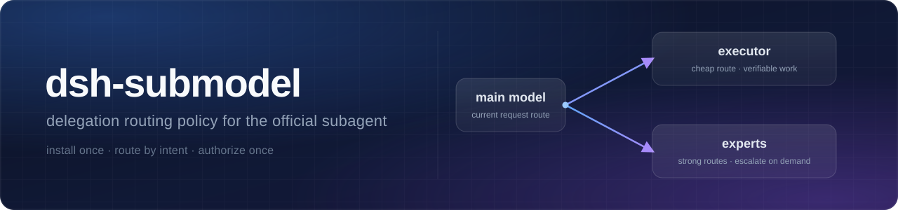

# dsh-submodel

**The default policy pack for the official subagent.** Install once and "who does what, when to delegate, and to whom" is configured for you.



[](https://www.npmjs.com/package/dsh-submodel)
[](https://www.npmjs.com/package/dsh-submodel)
[](https://github.com/angel291592/dsh-submodel/blob/main/LICENSE)
[](https://github.com/angel291592/dsh-submodel)
[](https://github.com/ylwl1997/dshbase/issues/221)

[中文](README.md) | **English**

It does **not** ship its own provider system — it reads the channels and models already configured in your
profile, writes a delegation policy into the system prompt, and adds one unified entry point
(`delegate_task`) on top of the official `subagent`. Since 0.2.0 the mode is decided by **route** (no model
naming convention required), and there is a first-run setup wizard plus `economyRoutes`. Requires DSH
`0.2.2-rc.1` (`0.2.1` and older are not compatible).

## Install

```bash
dsh plugin --profile <your-profile> add dsh-submodel   # 1. install
dsh --profile <your-profile>                           # 2. start (restart the profile after adding)
# 3. on the first session, follow "Configuration (two steps)" below; or call configure_submodel
```

## Configuration (two steps)

Configuration has **two layers**, and delegation only works when both are done:

| Layer | What it controls | If missing |
|---|---|---|
| ① Host authorization | DSH's own "subagent model selection" setting: which routes a subagent may switch to | Delegating to a non-inherited route fails with `child LLM route "…/…" is not allowed for this Session` |
| ② Plugin config | This package's `executor` (execution route) and `experts` (expert routes) | In boss mode there is no default delegation target: an `error` is logged and nothing is delegated |

### ① Host authorization (required)

By default the native `subagent` only lets a child inherit the parent session's route. To let a child switch
to an execution/expert route, authorize it in the host first:

- **GUI**: open **subagent model selection** in Settings (config id `subagent-model-selection-settings`),
  turn it on, and add the execution route and expert routes to the allow-list one by one.
- **Or write the profile patch YAML** (`~/.dsh/profiles/<your-profile>/cordis.patch.yml`; the file is an empty
  array `[]` by default — append the entry to that array):

```yaml
- id: subagent-model-selection-settings
  config:
    enabled: true
    allowedModels:
      - provider: your-provider
        model: your-model
      - provider: your-provider
        model: your-strong-model
```

Note: `allowedModels` must not be empty when `enabled: true`; host authorization only applies to **new
sessions**, so open a new session (or restart the profile) after writing it.

### ② Plugin configuration (pick one)

**Option A (recommended): call `configure_submodel` on the first session — it writes both places**

No YAML by hand. As long as you are the top-level agent, `autoConfigure` keeps its default `true`, and
`executor` is not configured yet, the `configure_submodel` tool appears on the first session:

1. Call it. It asks three questions — **execution route** (where verifiable execution blocks go; single
   choice), **expert routes** (models you may name when escalating; multi-choice), and **whether to write the
   host authorization row too** (recommended: yes);
2. On confirmation it uses the official `configEditor` to write **host authorization first, then plugin
   config** (the plugin config's `executor`, `experts` and `economyRoutes` all reflect your choices), so both
   take effect together;
3. It takes effect on the next session. Writing the plugin config reloads this plugin and the tool
   disappears afterwards — that is expected, not an error.

On clients without a GUI (headless / plain CLI) or when a required service is missing, no question card is
shown: the tool returns copyable manual YAML instead and **writes nothing**.

**Option B: five-line YAML by hand**

In your profile patch layer (`~/.dsh/profiles/<your-profile>/cordis.patch.yml`), override this package by id.
The file is an empty array `[]` by default: **replace `[]` with the entry below**; if it already has entries,
append this one to the array.

```yaml
- id: submodel
  config:
    executor:
      provider: your-provider
      model: your-model
```

Note: a profile patch **replaces the whole `config` block** of an entry — fields you leave out fall back to
their defaults (see the table below); they are not merged field by field with the built-in defaults.

Full field reference:

| Field | Default | Description |
|---|---|---|
| `enabled` | `true` | Master switch; when `false`, only an empty prompt section is registered and no tools/guards are installed |
| `autoConfigure` | `true` | Whether to register the `configure_submodel` wizard for first-run setup (visible only for a top-level agent whose `executor` is not configured); turn it off to configure everything manually |
| `preset` | `standard` | Only applies to that composition |
| `executor.provider` / `executor.model` | empty | Execution route: the default delegation target in boss mode; **leaving it empty logs an `error`** (see Troubleshooting). Switching the main model to this route also means Flash mode |
| `executor.reasoningEffort` | `max` | Default effort only when the caller did not specify one |
| `economyRoutes` | `[]` | Extra "cheap routes", each `{provider?, model}`: the current request matching any of them counts as Flash (`economize`) mode. Omit `provider` to match on `model` alone; **when non-empty, the legacy flash-suffix rule no longer applies** |
| `experts` | `[]` | Expert routes you may name explicitly when escalating, each `{label, provider, model, reasoningEffort?}`; `reasoningEffort` is reserved for now and does not affect delegation |
| `texts.economize` / `texts.boss` / `texts.child` | empty | When non-empty, replaces the built-in prompt section verbatim (no interpolation afterwards) |
| `toolName` | `list_subagent_models` | Tool name used as the capability gate for the policy section |
| `order` | `2850` | Order of the policy section in the system prompt |
| `guardNativeSubagent` | `true` | Whether to reject a non-economy-route (non-Flash mode) top-level agent that calls the native `subagent` without a complete provider/model pair |

## How it decides who does what (route-based since 0.2.0)

There are two modes, and the decision looks only at the **route of the current request** (`provider` +
`model`) — no model-name suffix is required:

1. Current request route **== the configured `executor` route** → **Flash (`economize`) mode**;
2. The request matches any route in **`economyRoutes`** → **Flash (`economize`) mode** (for multiple cheap routes);
3. When `economyRoutes` is empty, the legacy rule still applies: a model name ending in `flash` → **Flash
   (`economize`) mode**;
4. Everything else → **boss mode**.

Built-in behaviour:

- **Flash mode**: do the work yourself by default; ordinary subtasks go through `delegate_task` (no
  provider/model — the child inherits the current route); escalate only when "the problem itself is complex"
  or "it exceeds your execution limits", naming a route from `experts`.
- **Boss mode**: understanding, judgement and writing stay with the main model; verifiable execution blocks
  default to the configured `executor` route.
- **Children**: hard boundary — `delegate_task` / `subagent` / `subagent_fork` / `workflow` / `spawn_teammate`
  are unavailable to a child, preventing recursive delegation.
- **`delegate_task`**: same parameters as the native `subagent` (`description`, `prompt`, and optional
  `provider` / `model` / `reasoning_effort`; `provider` and `model` must be supplied **together** — one alone
  fails immediately). It goes through `ctx.tools.execute` and raises a real native call, so the host's
  allowlist / preflight / permissions still apply. Since 0.2.0 the semantics are "starts an independently
  managed subagent and **immediately returns its id**; the runtime notifies you when it finishes": do not poll
  repeatedly — use `list_agents` to look at live subagents, `send_message` to append, and `interrupt_agent` to
  stop. Call `list_subagent_models` first if you are unsure which routes are authorized.

Two typical calls:

```json
// 1) Boss → execution route: omit provider/model and the configured executor is filled in
{ "description": "run the tests", "prompt": "<complete task: goal, constraints, what has been tried>" }
```

```json
// 2) Escalate → expert route: provider/model together, and the route must be in the host allow-list
{ "description": "review the state machine", "prompt": "<complete task>", "provider": "your-provider", "model": "your-model" }
```

## Relationship to the official plugins

| Capability | Provided by |
|---|---|
| Status view `list_agents`, append `send_message`, stop `interrupt_agent` | Official `@deepseek-ai/dsh-tool-subagent-control` (this package does **not** register them) |
| Policy text, `delegate_task`, child guard, `configure_submodel` wizard | This package |
| Model selection itself (`provider` / `model` parameters of `subagent`) | Official subagent (this package only consumes it) |

## Compatibility

| DSH version | Status |
|---|---|
| `0.2.2-rc.1` | ✅ Target version: fixture + isolated-profile **real-host load verified**; GUI end-to-end is for the user to accept (**not verified**) |
| `0.2.1-rc.5` and older | ❌ Incompatible: no batch `ctx.tools.execute`, and no 0.2.2 child-route semantics |
| Other `0.2.x` versions | Not tested per version; `engines.dsh` declares `>=0.2.2-rc.1 <0.3.0`, so out-of-range versions are rejected by the installer |

## Troubleshooting

Fail-fast: startup warnings are logged only and never thrown; errors only surface when you call a tool.

| Symptom | Level | Meaning and fix |
|---|---|---|
| `config.executor.provider/model 未配置，自动委派不可用…` | `error` | No default delegation target: call `configure_submodel` or add `executor` manually as in "Configuration (two steps)" |
| `child LLM route "…/…" is not allowed for this Session` | error on delegation | **Host authorization missing** (or this route is not in the allow-list): open "subagent model selection", add the route (takes effect on new sessions), or re-run `configure_submodel` and accept the host-authorization write |
| `configure_submodel` is not visible | — | ① `executor` is already configured (the wizard intentionally appears only once); ② `autoConfigure` is `false`; ③ the native `subagent` in this session exposes no model-selection parameters (check that model selection is enabled in the profile/preset); ④ you are not the top-level agent |
| `configure_submodel` returns no question card | — | The client has no GUI (headless / plain CLI), so there is nobody to ask; the tool returns manual YAML and writes nothing — use Option B above |
| `当前 profile 无 agentPresets 服务，策略不生效` | `warn` | This profile has no agentPresets service; use a profile that supports compositions |
| `原生 subagent 未暴露 provider/model，delegate_task 不安装` | `warn` | The native `subagent` in this session exposes no model-selection parameters: the whole install (policy section / guard / tools) is skipped and retried automatically once the capability appears |
| `本会话未启用官方 subagent 模型选择，策略段不渲染` | `info` | Enable `subagent-model-selection-settings` in Settings (host authorization applies to new sessions only); tools are still installed subject to their own gate |

## Known limitations

- The policy text is Chinese by default; override it with `texts.*` (tool descriptions and some guard
  rejections stay in English).
- Applies only to the composition named by `preset` (default `standard`).
- No budget guard / nudging / failure re-routing (watchdog).
- `configure_submodel` writes exactly two places — this package's config row and the host authorization row
  (`subagent-model-selection-settings`); it does not create channels or credentials and does not touch other
  plugins.
- Model metadata has no price field, so which routes count as "cheap" is up to your configuration (the wizard
  only pre-fills candidates; it does not decide for you).
- Non-GUI clients have no question card, so use Option B (manual YAML).

## Rollback

```bash
dsh plugin --profile <your-profile> remove dsh-submodel
```

Removing the plugin leaves the host authorization row in the profile patch; to revert that too, delete the
`subagent-model-selection-settings` entry manually.

## Development and verification

```bash
npm install                                     # development dependency (schemastery)
node tests/unit/flash-routing-fixture.mjs ./lib # pure functions + lifecycle regression
python -m unittest discover -s tests/unit       # Python driver (run from the package root)
node tests/unit/public-profile-smoke.mjs        # deterministic smoke test with a clean user config
```

Current verification counts (CI runs the same commands on every push / PR, see `.github/workflows/ci.yml`):

<!-- verification counts: fixture / Python / smoke numbers live only in this table; update here if measurements differ. -->

| Check | Result |
|---|---|
| fixture | **104** assertions, `failed: 0` |
| Python driver | **7** test cases, `OK` |
| Public-profile smoke | **7** assertions, `failed: 0` |

GUI end-to-end (the `configure_submodel` card and both writes, `delegate_task` delegation, and switching the
main model to the execution route to enter economize mode) must be accepted by the user in a restarted real
GUI session and is **not verified yet**.
