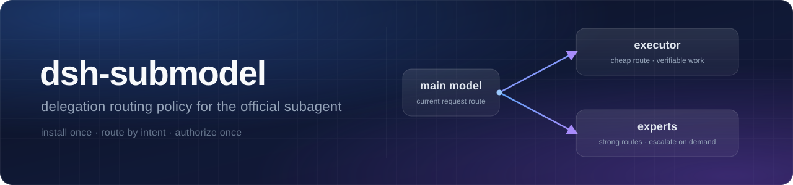

# dsh-submodel

**官方 subagent 的双向跨模型派活策略**：强主脑把常规执行下沉给便宜模型，便宜主脑把架构级难题升级给强模型——常规 token 留在便宜模型上，难题仍由强模型处理。

> **它解决什么**
> - **常规执行 / 检索**：留在便宜模型（例如 DeepSeek Flash）上，贵模型不做杂活。
> - **架构 / 复杂代码与逻辑**：升级给强专家模型（例如 Claude），质量不打折。
> - **双向都成立**：不管主脑是强模型还是便宜模型，都能按任务把活派给合适的另一档；被派出的子代理不能再次转包。
> - 每条路由用哪个 provider/model 由你配置；策略正文不含任何渠道或模型名。



[](https://www.npmjs.com/package/dsh-submodel)
[](https://www.npmjs.com/package/dsh-submodel)
[](https://github.com/angel291592/dsh-submodel/blob/main/LICENSE)
[](https://github.com/angel291592/dsh-submodel)

**中文** | [English](README.en.md)

在 **插件 → 派活模型设置** 中给性价比模型和专家模型分别排序，也可以给每个模型写一句用途备注。主模型可以按任务选择起点；启用自动换模型后，符合条件的失败会从所选位置往下尝试。DSH 管理模型渠道、凭据和子代理选模权限。`0.4.0` 要求 DSH `>=0.2.2-rc.5 <0.3.0`。

## 安装

```bash
dsh plugin --profile <你的 profile> add dsh-submodel   # 1. 安装
dsh --profile <你的 profile>                            # 2. 启动（装完插件需重启 profile）
# 3. 首次会话按下面「两步配置」完成授权与路由；或直接调用 configure_submodel
```

## 配置（两步）

切换子代理模型时，既要选择派活偏好，也要在 DSH 里允许相应模型：

| 层 | 管什么 | 缺失的后果 |
|---|---|---|
| ① 宿主授权 | 允许新会话把工作派给哪些模型 | 当前会话不能派给未授权的其他模型 |
| ② 插件配置 | 选择默认执行模型和可用的专家模型 | 没有默认执行模型时，强主脑无法自动选定日常委派目标 |

### ① 宿主授权（必须）

DSH 原生 `subagent` 默认只允许子代理沿用父会话的路由；要让子代理切到执行/专家路由，先做宿主授权：

- **界面**：在「插件」中打开 **子代理** 的设置，启用模型选择，并将执行、专家和备选模型逐一加入允许列表。
- **或手写 profile 补丁 YAML**（`~/.dsh/profiles/<你的 profile>/cordis.patch.yml`；该文件默认是空数组
  `[]`，把下面的条目追加进数组即可）：

```yaml
- id: subagent-model-selection-settings
  config:
    enabled: true
    allowedModels:
      - provider: your-provider
        model: your-model
      - provider: your-provider
        model: your-strong-model
      - provider: your-other-provider
        model: your-backup-model
```

注意：`enabled: true` 时 `allowedModels` 不能为空；宿主授权**只对新会话生效**，写完要新开会话（或重启 profile）。

### ② 插件配置

**设置页**：在 **插件 → 派活模型设置** 打开详情。两组都可添加模型、调整顺序并写用途备注，例如「代码优先」。每组第一位是通常的起点，主模型也可根据备注选其他项。要用到的模型请在「子代理」设置单独授权。另一页先保存时，本页会保留草稿；读取最新设置并核对后再保存。连接更换后请重新载入页面。

**首次配置向导**：顶层主代理尚未设置执行模型且 `autoConfigure` 开启时，可调用 `configure_submodel`。向导先询问执行与专家模型，再单独询问是否同时添加子代理模型授权。两处设置分别保存并报告结果；其中一处失败时，按向导提示复查。保存执行模型后，向导入口随即隐藏。

**无设置页时**：在 profile 补丁中添加或更新如下 `submodel` 条目。已有字段一并保留。没有可回答提问卡的客户端时，向导会说明手动配置的两步。

```yaml
- id: submodel
  config:
    modelGroups:
      executors:
        - { provider: your-provider, model: your-model, note: 代码优先 }
        - { provider: your-other-provider, model: your-backup-model }
      experts:
        - { provider: your-provider, model: your-strong-model, note: 架构判断 }
```

注意：profile 补丁对某一条目的 `config` 是**整段替换**——没写的字段回落到默认值（见下表），
不会和内置默认值逐字段合并。

完整字段：

| 字段 | 默认值 | 说明 |
|---|---|---|
| `enabled` | `true` | 总开关；`false` 时只注册一个空段，不装任何工具/guard |
| `autoConfigure` | `true` | 是否在首次配置时注册 `configure_submodel` 向导（顶层主代理且 `executor` 未配置才可见）；关掉后完全手动配置 |
| `preset` | `standard` | 只对这个 composition 生效 |
| `teamFit.enabled` | `false` | 团队队形自检段开关（0.3.0+）：需总开关 `enabled` 同时为 `true`、并启用官方 Agent Teams；只对目标 preset 的顶层主代理显示，详见下文。默认关闭 = 回滚态 |
| `modelGroups` | `legacy`（沿用旧配置） | `executors` 与 `experts` 是两组有序列表，每项 `{provider, model, note?, reasoningEffort?}`。组内不能重复；每个模型都可设默认推理强度：委派未点名档位或自动改派落到该模型时使用，留空交给模型，调用点名的档位优先 |
| `executor`、`experts` | 未配置 | 仅在未保存两组列表时使用。旧执行模型省略 `reasoningEffort` 时沿用 `max`，设为 `""` 时用模型默认 |
| `economyRoutes` | `[]` | 额外声明「便宜路由」，每项 `{provider?, model}`：本次请求命中任一项即算 Flash（economize）模式。`provider` 省略时只按 `model` 匹配；**非空时旧的 flash 后缀规则不再生效** |
| `texts.economize` / `texts.boss` / `texts.child` | 空 | 非空时整段替换内置正文（替换后不再插值） |
| `toolName` | `list_subagent_models` | 策略段的能力门控工具名 |
| `order` | `2850` | 策略段在系统提示词里的顺序 |
| `guardNativeSubagent` | `true` | 强主脑直接用原生 `subagent` 时要求完整的渠道与模型 |
| `fallbacks` | `[]` | 仅旧配置使用。每项 `{primary: {provider, model}, alternatives: [...]}`；首次保存组列表后改用组内顺序 |
| `watchdog.mode` | `off` | `off` 关闭，`notify` 提醒收尾，`stop` 宽限后提示手动停止，`retry` 在符合条件时改派 |
| `watchdog.tiers` | `[expert]` | 选择 `expert`（专家）和／或 `executor`（执行） |
| `watchdog.warnTokens` | `100000` | 已报告的累计 token 阈值（正整数） |
| `watchdog.graceMs` | `60000` | 成功发出收尾提醒后等待的时间，范围 `1000`–`600000` 毫秒 |
| `watchdog.maxRetries` | `1` | 每笔任务最多自动改派 `0`–`2` 次 |

## 用量提醒与自动换模型

**用量提醒**默认关闭，只观察经 `delegate_task` 启动的、属于选定组的本机子任务。用量按模型报告值累计，单次请求可能超过提醒值。宿主把漏报和明确报零都记成零，所以两者都按未知处理。「提醒后再等」在页面用秒表示，时间到后只提示你手动停止，不会代你停止任务。

**失败后尝试下一位模型**开启后，只有原模型耗尽宿主的有限重试（默认首次失败后再试 5 次，实际少于 5 次则不换），整个任务用量已知且低于提醒值，并且没有部分结果、工具调用、人工停止或续聊，才会尝试同一组的下一位。从选中的位置往后，不回头、不跳过不可用或未授权项。切换后的模型使用它自己配置的默认档位（未配置则由模型决定），不继承原模型的档位。当前设置与会话记录都须允许下一位。它可以来自其他渠道，该渠道会收到任务，也可能收取费用。关闭用量提醒会撤销等待中的动作，已经被宿主受理的子任务照常收尾。

整组累计用量要求每次请求都提供可核实的样本。某次漏报或报零时，即使稍后请求报告了用量，自动换模型也会停止。已有配置在保存两组模型前保持原行为。保存组列表后请把希望保留的旧备选添加到对应组。一个渠道与模型的组合若同时在两组，显式点名按专家组处理。

## 它怎么判断该谁干（0.2.0 起按路由）

两种模式，判定只看**本次请求的路由**（`provider` + `model`），不再要求模型名带特定后缀：

1. 本次请求的模型命中「性价比模型」组（旧配置下匹配 `executor`）→ **Flash（`economize`）模式**；
2. 命中配置的 **`economyRoutes`** 任一条 → **Flash（`economize`）模式**（有多条便宜路由时用）；
3. `economyRoutes` 为空时保留旧版兼容：模型名以 `flash` 结尾 → **Flash（`economize`）模式**；
4. 其余 → **强主脑（`boss`）模式**。

内置正文与行为：

- **Flash 模式**：默认自己干；普通子任务用 `delegate_task`（不传 provider/model，子代继承当前路由）；
  只有问题足够复杂或超出执行上限时才升级，按专家组顺序和用途备注点名。
- **强主脑模式**：理解、判断和写作自己来。可验证的执行块默认派给性价比组首位，也可以按用途备注点名其他模型。
- **子代**：硬边界——`delegate_task` / `subagent` / `subagent_fork` / `workflow` / `spawn_teammate`
  一律不可用，防止递归派活。
- **`delegate_task`**：参数与原生 `subagent` 相同（`description`、`prompt`，以及可选的
  `provider` / `model` / `reasoning_effort`；`provider` 与 `model` 必须**成对**传，只给一个会立即失败）。
  调用未点名 `reasoning_effort` 时，用该模型在两组列表里配置的默认档位（未配置则由模型决定）。
  经 `ctx.tools.execute` 发起真正的原生调用，宿主的 allowlist / 预检 / 权限照旧生效。
  启动成功时原样返回 `{kind: 'activation', name}`。`name` 可用于查看或发信。结果由宿主在子任务结束后通知。
  不确定有哪些已授权路由时先调 `list_subagent_models`。

两个典型用法：

```json
// 1) 强主脑 → 执行路由：不传 provider/model，自动补 executor
{ "description": "跑通测试", "prompt": "<完整任务说明：目标、约束、已试过的方案>" }
```

```json
// 2) 升级 → 专家路由：provider/model 成对，且必须已在宿主授权列表里
{ "description": "复核状态机", "prompt": "<完整任务说明>", "provider": "your-provider", "model": "your-model" }
```

## 团队队形自检（可选，0.3.0+）

这是给**启用了 Agent Teams 的用户**的附加提示词段，默认关闭。打开后，顶层主代理在每轮实际任务
开始前先判断「能不能并行、开几个队友、每个用什么模型」，并把结论用下面三个行首连续报给你：

```
可并行性：
串行点：
决定：
```

- **问候不触发**；普通追问、进度查询和重试沿用已经给出的决定，只有任务范围或可改动文件范围变化才重判。
- **串行**时第三行固定为「决定：本次串行，不用任务板」：任务板新增 0 项、启动队友 0 个，主代理自己做完。
- **并行**时写「决定：并行 N 个队友」，并在同一行写清每块工作、负责人、写域（只读也注明）、具体模型、
  验收方法和依赖；只有能拆成 2–4 个互不争写、可独立验收的块时才并行。
- 并行时任务板记录每块的 `write_scopes` 与 `blocked_by`；共享文件、集成、提交和最终验证由主代理独占。
- 模型分配沿用本包已有的模型路由（见上一节）：普通执行块走 `delegate_task`；独立审查使用全新上下文；
  升级专家仍按「问题复杂度 / 执行瓶颈」判据，不因审查或风险标签直接跳档。

**前提与开关**：需要同时满足 ① 官方 Agent Teams 已启用；② 本包 `enabled: true`（默认）；
③ `teamFit.enabled: true`（默认 `false`）。只对目标 `preset`（默认 `standard`）的**顶层主代理**生效；
子代理与其他 composition 不显示；普通用户 fork 出来的会话（只带 `parentSession`）仍按主脑处理。

```yaml
# 只追加这一项；profile 补丁会整段替换 config，已有字段必须一起保留。
- id: submodel
  config:
    teamFit:
      enabled: true
```

> 上面只示范新增字段。若你已有 `executor` / `experts` 等配置，请在同一 `config` 块里一并保留——
> profile 补丁是**整段替换**，不会逐字段合并。

**回滚**：把 `teamFit.enabled` 设为 `false` 并重启 profile 即可完全关闭（不必卸载插件）；
总开关 `enabled: false` 同样有效。团队关闭或服务查询失败时，这段正文自动隐藏，不影响其他提示词。

## 与官方插件的边界

| 能力 | 提供方 |
|---|---|
| 查看、发信、等待、停止 | 宿主提供 `list_agents`、`send_message`、`wait_agent` 和可选的 `interrupt_agent` |
| 派活规则、`delegate_task`、设置页面和向导、用量看护 | 本包 |
| 选模授权与任务板 | 宿主管理，任务板由 Agent Teams 开关控制 |

`list_agents` 返回整棵子代理树。`send_message` 确认投递，任务结果会另行送达。`wait_agent` 等待收件箱输入或完成通知，正常超时后可继续处理别的工作。`interrupt_agent` 在标准预设默认关闭，可按宿主指南启用；也可以在「子代理」面板停止任务。中断被受理后，以任务结束记录为准。

## 兼容性

| DSH 版本 | 验证状态 |
|---|---|
| `0.2.2-rc.5` | 安装版命令行开启隔离 Web 已验证设置页、派活和控制工具。桌面试装、npm 下载版命令行待验收 |
| `0.2.2-rc.1`–`rc.4` | 使用对应宿主版本时可安装 `dsh-submodel@0.3.0`，或升级 DSH |
| `>=0.2.2-rc.5 <0.3.0` 内其他版本 | 声明兼容范围内，待逐版验证 |

## 故障排查

| 现象 | 处理方法 |
|---|---|
| 没有可用的派活执行目标 | 到插件详情选择执行模型，或使用首次配置向导 |
| 当前会话无权使用所选模型 | 在「子代理」设置允许该模型，再新开会话 |
| 模型列表加载失败 | 在设置页点「重试加载模型」。已保存但暂时不可用的选择可以保留或删除 |
| 看不到向导 | 向导只在目标预设的顶层主代理、执行模型未配置且原生选模工具可用时出现 |
| 没有可用的设置页或提问卡 | 按「配置（两步）」通过 profile 补丁设置 |

## 已知限制

- 策略范围由 `preset` 指定。已有在线代理沿用装载时的派活偏好，新装载会读取保存值。宿主选模授权以会话记录为准，只影响新会话。
- `texts.*` 可保留自定义提示。升级前请核对其中使用的旧控制工具名。
- 队形自检为模型提供提示，模型决定是否执行和开多少队友。

## 回滚

```bash
dsh plugin --profile <你的 profile> remove dsh-submodel
```

插件停用或移除后，宿主的授权不会自动撤销。需要回退时，在「子代理」设置恢复原来的授权列表。若同时更换了旧插件，先停用新插件，再恢复备份的旧入口和 profile 配置，重启并开新会话确认只剩一个派活策略。

只关团队队形自检、保留其他功能：把 `teamFit.enabled` 设为 `false` 并重启 profile（不必卸载插件）。

## 开发与验证

```bash
npm install                                     # 安装开发依赖（schemastery）
node tests/unit/flash-routing-fixture.mjs ./lib # 纯函数 + 生命周期回归
python -m unittest discover -s tests/unit       # Python 驱动（包根执行）
node tests/unit/public-profile-smoke.mjs        # 干净用户配置的确定性冒烟
```

当前验证计数（CI 在每次 push / PR 跑同一组命令，见 `.github/workflows/ci.yml`）：

<!-- 验证计数：fixture / Python / smoke 三处数字集中在这里；实测有出入时只改本表。 -->

| 检查 | 结果 |
|---|---|
| fixture | **141** 条断言，`failed: 0` |
| Python 驱动 | **7** 个用例 `OK` |
| 公共 profile 冒烟 | **8** 条断言，`failed: 0` |

隔离 Web 验证使用本地模拟模型，覆盖保存与重开、冲突草稿、目录恢复、连接更换、亮暗主题和键盘操作；也检查了官方控制工具和用量看护。真实 Desktop 配置与付费模型的组合未由这些检查验证。队形自检约束的是提示词，不保证模型逐字复述。

## 参与贡献

- 提 issue / PR 前先看[贡献指南](CONTRIBUTING.md)（English: [CONTRIBUTING.en.md](CONTRIBUTING.en.md)）：
  要跑的三条测试、提交格式、以及不该带进仓库的东西都写在那里。
- 安全问题请走私密渠道（[安全政策](SECURITY.md)），不要开公开 issue。
- 参与本项目即视为同意[行为准则](CODE_OF_CONDUCT.md)。

## 发版（维护者）

### 统一维护与同步发布

本仓库是插件的唯一维护入口。功能、修复和打包文档都在这里更新。本机可以在隔离的 DSH
配置环境中先试装候选包。每次插件更新验证通过后，维护者必须同步发布对应的开源版本，补齐
变更记录、Git 标签和 npm 发布包。本机日常使用同一个经过验证的发布版本。

渠道、模型选择、预算参数和密钥由用户保存在自己的 DSH 配置或凭据存储。公开示例使用占位值。
推送前核对待发布提交、`npm pack --dry-run` 的文件清单和实际入包内容。将真实渠道与模型映射、
本机路径、配置备份、凭据和运行记录排除在 Git 和发布包之外。`reference/` 里的本机参考资料和
`docs/plans/` 里的私有计划留在本机。单独调整个人配置无需为插件发版。

### 发布步骤

发布走 GitHub Actions + npm **Trusted Publishing（OIDC）**，本机与仓库都不保存 npm 令牌：

1. 审阅 `package.json` 的版本和 [CHANGELOG.md](CHANGELOG.md) 的对应条目。运行 `pwsh scripts/release.ps1 <版本> -FromIndex`，从暂存内容生成**仅本地**的候选包。脚本不改版本、不提交、不打标签。
2. 核对包文件清单、`tarball-sha256`（整个压缩包）和 `pack-content-sha256`（每个文件的内容），在隔离环境和有回退准备的桌面环境试装同一候选包。
3. 获准发布后，在干净的 `main` 上准备已审阅的提交，运行 `pwsh scripts/release.ps1 <版本> -ExpectedContentSha256 <包内容摘要> -Publish`。脚本核对候选包后，推送已审阅的提交和包含摘要的注解标签。
4. [发布工作流](.github/workflows/release.yml) 从该提交重打包，检查同一内容摘要，再发布检查过的文件。随后从 npm 下载精确版本复核，并同步 GitHub Release。

首次接入需在 npm 包设置里一次性配置 Trusted Publisher（仓库 `angel291592/dsh-submodel`、
工作流 `release.yml`，并允许 Direct publish），之后发版不再需要 npm 密码 / 动态码 / 令牌。
