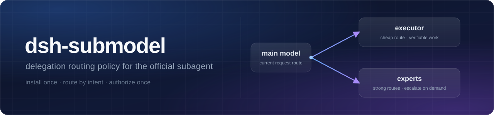

# dsh-submodel

**官方 subagent 的默认策略包**：装上一次配好「什么时候自己干、什么时候派出去、派给谁」。



[](https://www.npmjs.com/package/dsh-submodel)
[](https://www.npmjs.com/package/dsh-submodel)
[](https://github.com/angel291592/dsh-submodel/blob/main/LICENSE)
[](https://github.com/angel291592/dsh-submodel)
[](https://github.com/ylwl1997/dshbase/issues/221)

**中文** | [English](README.en.md)

它**不新建 provider 体系**——只读你 profile 里已有的渠道与模型配置，把委派策略写进系统提示词，
并给官方 `subagent` 补一个统一的委派入口 `delegate_task`。0.2.0 起模式按**路由**判定（不再依赖
模型命名约定），并提供首次配置向导与 `economyRoutes`；要求 DSH `0.2.2-rc.1`（`0.2.1` 及更早不兼容）。

## 安装

```bash
dsh plugin --profile <你的 profile> add dsh-submodel   # 1. 安装
dsh --profile <你的 profile>                            # 2. 启动（装完插件需重启 profile）
# 3. 首次会话按下面「两步配置」完成授权与路由；或直接调用 configure_submodel
```

## 配置（两步）

配置分**两层**，缺一层都派不出去：

| 层 | 管什么 | 缺失的后果 |
|---|---|---|
| ① 宿主授权 | DSH 自己的「子代理模型选择」设置：允许子代理切到哪些路由 | 子代理要切到非继承路由时，派工报 `child LLM route "…/…" is not allowed for this Session` |
| ② 插件配置 | 本包的 `executor`（执行路由）与 `experts`（专家路由） | 强主脑模式下没有默认派工目标，只记 error 日志、不派工 |

### ① 宿主授权（必须）

DSH 原生 `subagent` 默认只允许子代理沿用父会话的路由；要让子代理切到执行/专家路由，先做宿主授权：

- **GUI**：打开「设置」里的 **子代理模型选择**（配置项 id 为 `subagent-model-selection-settings`），
  打开开关，并把执行路由、专家路由**逐条**加入允许列表。
- **或手写 profile 补丁 YAML**（`~/.dsh/profiles/<你的 profile>/cordis.patch.yml`；该文件默认是空数组
  `[]`，把下面的条目追加进数组即可）：

```yaml
- id: subagent-model-selection-settings
  config:
    enabled: true
    allowedModels:
      - provider: your-provider
        model: your-model
      - provider: your-provider
        model: your-strong-model
```

注意：`enabled: true` 时 `allowedModels` 不能为空；宿主授权**只对新会话生效**，写完要新开会话（或重启 profile）。

### ② 插件配置（二选一）

**方式 A（推荐）：首次会话调用 `configure_submodel` 自动写两处**

不用手写 YAML。只要满足：顶层主代理 + `autoConfigure` 保持默认 `true` + `executor` 还没配置，
首次会话里就会出现 `configure_submodel` 工具：

1. 调用它，会依次问 3 个问题——**执行路由**（日常可验证的执行块派给谁，单选）、
   **专家路由**（需要升级时允许点名的模型，可多选）、**是否同时写宿主授权表**（推荐「是」）；
2. 确认后它用官方 `configEditor` **先写宿主授权、再写插件配置**（插件配置里的 `executor`、`experts`
   与 `economyRoutes` 都按你的选择落盘），两处一起生效；
3. 新会话生效。写入成功后本插件会重载、该工具随之消失——这是预期的，不是出错。

没有 GUI 客户端（headless / 纯 CLI）或相关服务不可用时，它不会弹卡，而是直接返回可复制的手动
YAML，并且**不会写任何配置**。

**方式 B：手动写 5 行 YAML**

在 profile 补丁层（`~/.dsh/profiles/<你的 profile>/cordis.patch.yml`）里按 id 覆盖配置。
该文件默认是空数组 `[]`：**把 `[]` 替换成下面的条目**；已有其他条目时，把它追加到数组里。

```yaml
- id: submodel
  config:
    executor:
      provider: your-provider
      model: your-model
```

注意：profile 补丁对某一条目的 `config` 是**整段替换**——没写的字段回落到默认值（见下表），
不会和内置默认值逐字段合并。

完整字段：

| 字段 | 默认值 | 说明 |
|---|---|---|
| `enabled` | `true` | 总开关；`false` 时只注册一个空段，不装任何工具/guard |
| `autoConfigure` | `true` | 是否在首次配置时注册 `configure_submodel` 向导（顶层主代理且 `executor` 未配置才可见）；关掉后完全手动配置 |
| `preset` | `standard` | 只对这个 composition 生效 |
| `executor.provider` / `executor.model` | 空 | 执行路由：强主脑的默认派工目标；**留空会记 error 日志**（见故障排查）。主模型切到这条路由本身也等于进入 Flash 模式 |
| `executor.reasoningEffort` | `max` | 只在调用方没显式指定档位时作缺省 |
| `economyRoutes` | `[]` | 额外声明「便宜路由」，每项 `{provider?, model}`：本次请求命中任一项即算 Flash（economize）模式。`provider` 省略时只按 `model` 匹配；**非空时旧的 flash 后缀规则不再生效** |
| `experts` | `[]` | 允许升级时显式点名的专家路由列表，每项 `{label, provider, model, reasoningEffort?}`；`reasoningEffort` 目前为预留字段，不影响派工 |
| `texts.economize` / `texts.boss` / `texts.child` | 空 | 非空时整段替换内置正文（替换后不再插值） |
| `toolName` | `list_subagent_models` | 策略段的能力门控工具名 |
| `order` | `2850` | 策略段在系统提示词里的顺序 |
| `guardNativeSubagent` | `true` | 是否拦截"非经济路由（非 Flash 模式）顶层用原生 `subagent` 却不给完整 provider/model" |

## 它怎么判断该谁干（0.2.0 起按路由）

两种模式，判定只看**本次请求的路由**（`provider` + `model`），不再要求模型名带特定后缀：

1. 本次请求路由 **== 配置的 `executor` 路由** → **Flash（`economize`）模式**；
2. 命中配置的 **`economyRoutes`** 任一条 → **Flash（`economize`）模式**（有多条便宜路由时用）；
3. `economyRoutes` 为空时保留旧版兼容：模型名以 `flash` 结尾 → **Flash（`economize`）模式**；
4. 其余 → **强主脑（`boss`）模式**。

内置正文与行为：

- **Flash 模式**：默认自己干；普通子任务用 `delegate_task`（不传 provider/model，子代继承当前路由）；
  只有"问题本身够复杂"或"超出执行上限"时才升级，升级时从 `experts` 里点名。
- **强主脑模式**：理解/判断/写作自己来；可验证的执行块默认派给 `executor` 配置的执行路由。
- **子代**：硬边界——`delegate_task` / `subagent` / `subagent_fork` / `workflow` / `spawn_teammate`
  一律不可用，防止递归派活。
- **`delegate_task`**：参数与原生 `subagent` 相同（`description`、`prompt`，以及可选的
  `provider` / `model` / `reasoning_effort`；`provider` 与 `model` 必须**成对**传，只给一个会立即失败）。
  经 `ctx.tools.execute` 发起真正的原生调用，宿主的 allowlist / 预检 / 权限照旧生效。
  0.2.0 起语义为「启动后**立即返回子会话 id**，完成时由运行时通知」：不要反复轮询，需要查看在线
  子代理用 `list_agents`、追加消息用 `send_message`、停止用 `interrupt_agent`。
  不确定有哪些已授权路由时先调 `list_subagent_models`。

两个典型用法：

```json
// 1) 强主脑 → 执行路由：不传 provider/model，自动补 executor
{ "description": "跑通测试", "prompt": "<完整任务说明：目标、约束、已试过的方案>" }
```

```json
// 2) 升级 → 专家路由：provider/model 成对，且必须已在宿主授权列表里
{ "description": "复核状态机", "prompt": "<完整任务说明>", "provider": "your-provider", "model": "your-model" }
```

## 与官方插件的边界

| 能力 | 提供方 |
|---|---|
| 状态查看 `list_agents`、追加消息 `send_message`、停止 `interrupt_agent` | 官方 `@deepseek-ai/dsh-tool-subagent-control`（本包**不重复注册**） |
| 策略正文、`delegate_task`、子代 guard、`configure_submodel` 向导 | 本包 |
| 模型选择能力本身（`subagent` 的 `provider`/`model` 参数） | 官方 subagent（本包只消费） |

## 兼容性

| DSH 版本 | 状态 |
|---|---|
| `0.2.2-rc.1` | ✅ 目标版本：fixture + 隔离 profile **真机装载已验**；GUI 端到端由用户验收（**未验证**） |
| `0.2.1-rc.5` 及更早 | ❌ 不兼容：没有批量 `ctx.tools.execute`，也没有 0.2.2 的子代理路由语义 |
| 其他 `0.2.x` 版本 | 未逐版实测；`engines.dsh` 声明 `>=0.2.2-rc.1 <0.3.0`，范围外的版本会被安装器拦住 |

## 故障排查

fail-fast：启动期的告警只记日志、绝不抛；只有你主动调用工具时才可能收到错误。

| 现象 | 级别 | 含义与处理 |
|---|---|---|
| `config.executor.provider/model 未配置，自动委派不可用…` | `error` | 没有默认派工目标：调用 `configure_submodel` 自动配置，或按上面「两步配置」手动补 `executor` |
| `child LLM route "…/…" is not allowed for this Session` | 派工时报错 | **宿主授权缺失**（或没包含这条路由）：打开「子代理模型选择」并把该路由加入允许列表（新会话生效）；或重新运行 `configure_submodel` 并勾选写宿主授权 |
| 看不到 `configure_submodel` | — | ① `executor` 已配置（向导按设计只出现一次）；② `autoConfigure` 被设为 `false`；③ 当前会话的原生 `subagent` 没有选模参数（先确认 profile/preset 开启了模型选择）；④ 当前不是顶层主代理 |
| 调用 `configure_submodel` 后没有弹提问卡 | — | 当前客户端没有 GUI（headless / 纯 CLI），没人可问；工具会返回手动 YAML 且不写配置，按「方式 B」手写即可 |
| `当前 profile 无 agentPresets 服务，策略不生效` | `warn` | 该 profile 没有 agentPresets 服务；换一个支持 composition 的 profile |
| `原生 subagent 未暴露 provider/model，delegate_task 不安装` | `warn` | 本会话的原生 `subagent` 没有选模参数：该 agent 上**整套安装**（策略段 / guard / 工具）都会跳过，等能力出现后由 `tools/change` 或 `agent/pre-step` 自动补装 |
| `本会话未启用官方 subagent 模型选择，策略段不渲染` | `info` | 去设置里启用 `subagent-model-selection-settings`（宿主授权只对新会话生效）；工具本身仍按注册门控安装 |

## 已知限制

- 策略正文默认中文；可用 `texts.*` 整段覆盖（工具描述与部分 guard 拒绝理由仍为英文）。
- 只对 `preset` 指定的 composition 生效（默认 `standard`）。
- 不提供预算护栏 / 催收 / 故障改派（watchdog）。
- `configure_submodel` 只写两处：本插件配置行 + 宿主授权行（`subagent-model-selection-settings`）；
  不创建渠道/密钥，也不改其他插件。
- 模型元数据里没有价格字段，哪些路由算"便宜"由你的配置决定（向导只做候选预填，不替你拍板）。
- 非 GUI 客户端没有提问卡可用，只能用「方式 B」手动 YAML。

## 回滚

```bash
dsh plugin --profile <你的 profile> remove dsh-submodel
```

插件移除后，宿主授权行仍在 profile 补丁里；如需一并撤销，手动删除 `subagent-model-selection-settings` 条目即可。

## 开发与验证

```bash
npm install                                     # 安装开发依赖（schemastery）
node tests/unit/flash-routing-fixture.mjs ./lib # 纯函数 + 生命周期回归
python -m unittest discover -s tests/unit       # Python 驱动（包根执行）
node tests/unit/public-profile-smoke.mjs        # 干净用户配置的确定性冒烟
```

当前验证计数（CI 在每次 push / PR 跑同一组命令，见 `.github/workflows/ci.yml`）：

<!-- 验证计数：fixture / Python / smoke 三处数字集中在这里；实测有出入时只改本表。 -->

| 检查 | 结果 |
|---|---|
| fixture | **104** 条断言，`failed: 0` |
| Python 驱动 | **7** 个用例 `OK` |
| 公共 profile 冒烟 | **7** 条断言，`failed: 0` |

GUI 端到端（`configure_submodel` 弹卡与两处写入、`delegate_task` 派工、主模型切到执行路由后进入
economize 模式）需要在重启后的真实 GUI 会话里由用户验收，**尚未验证**。

## 发版（维护者）

发布走 GitHub Actions + npm **Trusted Publishing（OIDC）**，本机与仓库都不保存 npm 令牌：

1. 在 `CHANGELOG.md` 顶部补 `## <版本>（YYYY-MM-DD）` 段；
2. 在 `main` 分支运行 `pwsh scripts/release.ps1 <版本>`：跑门禁 → 改 `package.json` 版本 →
   提交 → 打 tag → push，并轮询 npm 直到看到新版本；
3. 仓库的 `release` 工作流（`.github/workflows/release.yml`）在 tag push 后再次跑测试并自动
   `npm publish`；`scripts/release.ps1` 验证成功后会尽量创建 GitHub Release。

首次接入需在 npm 包设置里一次性配置 Trusted Publisher（仓库 `angel291592/dsh-submodel`、
工作流 `release.yml`，并允许 Direct publish），之后发版不再需要 npm 密码 / 动态码 / 令牌。
